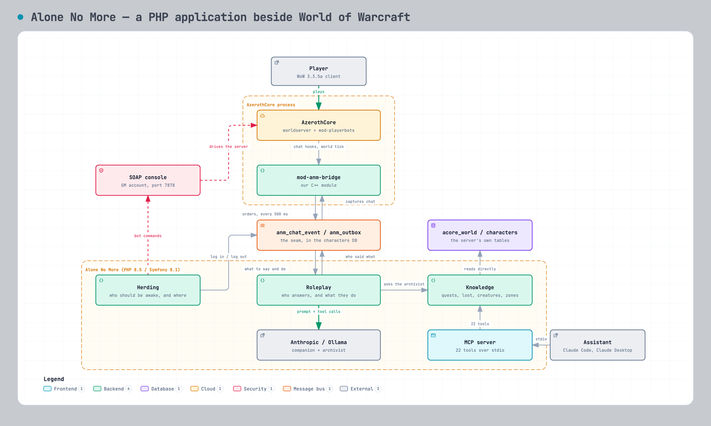

# Alone No More

**AI companions for a private World of Warcraft server — built with Symfony AI and MCP.**

> [!IMPORTANT]
> **For educational purposes only.** Alone No More is a non-commercial learning project, built
> for the Symfony AI & MCP Hackathon. It runs against a private, local AzerothCore server, and is
> not affiliated with, endorsed by, or connected to Blizzard Entertainment. World of Warcraft is a
> trademark of Blizzard Entertainment, Inc. No game client files are included in this repository.

▶ **[Watch the 90-second demo](https://youtu.be/VIDEO_ID)**
<!-- TODO: replace VIDEO_ID with the YouTube link before submitting -->

---

A private WoW server gives you the whole world and nobody to share it with. mod-playerbots can
fill it with bots, but they stand in silence and take orders only as slash commands.

Alone No More is a Symfony application that stands beside the server and turns those bots into
company: a crowd wherever you are, and companions who talk, remember and help — in plain English.

## What it does

**A world that is lived in.** About fifty level-appropriate, same-faction bots in the zone you are
standing in, and more in the capitals. They arrive where they belong, never in front of you.

**Companions who talk, from the game's own data.** Quests, loot and creatures are read from the
server's database, never invented:

> *"You mean "Dry Times", which asks for a Cask of Merlot, a Bottle of Moonshine and a Skin of
> Sweet Rum."* — Anduril

**…and say so when they cannot.**

> *"Klemprime, there is no Redridge Mongrel within forty yards of us."* — Khaoh

**Companions who act on plain English.** Lead the way, fight until a quest is done, sell the
junk, hand over and equip gear — no slash commands.

> *"Follow me, Klemprime. Smith Argus is a short walk south-east, some four hundred paces, and I
> trust the weather will hold."*
>
> *"I have just sold the lot, including a Feeble Sword and seven Fractured Canines. Poor
> pickings, but gold is gold."* — Anduril

**Companions who remember** — the conversation, what they overheard, and what you still need.

> *"Only the Bottle of Moonshine now stands between you and "Dry Times" complete."* — Anduril,
> minutes later

**The whole world, from an assistant.** Twenty-two MCP tools: ask Claude to set up your party
before you log in, make the zone busier, or tell you what to do next.

Every quote above is from a real session, and that session is in this repository.

## Built with Symfony AI

- the **AI Bundle** with the **Anthropic** and **Ollama** platforms;
- **Agents** with tool calling and memory: a Claude Sonnet companion that consults a Claude Haiku
  archivist;
- the **MCP Bundle**, which exposes the world to assistants like Claude Desktop as 22 tools.

On Symfony 8.1 and PHP 8.5, beside [AzerothCore](https://www.azerothcore.org/) with
[mod-playerbots](https://github.com/mod-playerbots/azerothcore-wotlk) and a small C++ module of
our own.

## Try it

A recording of that real session is committed, and the whole application runs against it — no
game server, no database, no game client:

```bash
git clone <this repo> && cd alone-no-more && composer install

APP_ENV=replay bin/console anm:world Klemprime            # the recorded world
APP_ENV=replay bin/console anm:prompt Anduril Klemprime   # what grounds a companion
APP_ENV=replay bin/console anm:talk Klemprime             # talk to him — Claude or Ollama
```

| | You need | Guide |
|---|---|---|
| **Look around** | PHP and Composer | [docs/try-it.md](docs/try-it.md) |
| **Talk to a companion** | Ollama (free, local), or an Anthropic key | [docs/try-it.md](docs/try-it.md#2-talk-to-a-companion) |
| **Build everything yourself** | AzerothCore with mod-playerbots, our C++ module compiled in, and a 3.3.5a client | [docs/real-server.md](docs/real-server.md) |

## How it is built

<picture>
  <source media="(prefers-color-scheme: dark)" srcset="docs/architecture-dark.png">
  
</picture>

## Documentation

| | |
|---|---|
| [Try it](docs/try-it.md) | The recording, talking to a companion, and Claude Desktop over MCP |
| [How it works](docs/how-it-works.md) | One line of chat end to end, the two models, memory, the crowd |
| [The MCP tools](docs/mcp-tools.md) | All twenty-two, and which of them change the world |
| [Running against a real server](docs/real-server.md) | Building AzerothCore, mod-playerbots and our module, step by step |
| [The server module](docs/the-server-module.md) | The C++ inside the worldserver, and why it has to be there |
| [Development](docs/development.md) | Tests, static analysis, layers, and every command |
| [Architecture](docs/architecture.html) | The interactive diagram — download and open locally |
