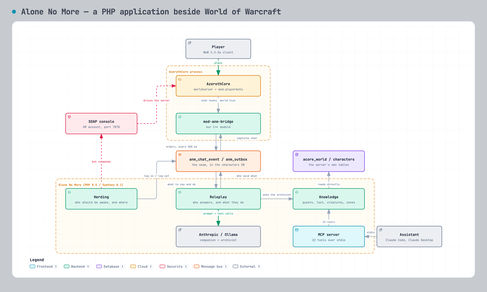

# How it works

<picture>
  <source media="(prefers-color-scheme: dark)" srcset="architecture-dark.png">
  
</picture>

**→ [architecture.html](architecture.html)** — the same picture, interactive and self-contained:
light and dark, click any box to trace what it touches, export to PNG or SVG. GitHub serves HTML
as source rather than rendering it, so download the file and open it locally.

## One line of chat, end to end

1. The player types in party chat. **`mod-anm-bridge`**, our C++ module inside the worldserver,
   hears it and writes it to `anm_chat_event`.
2. The listener (`bin/console anm:listen`) reads it, decides which companion answers, and builds
   that companion's system prompt from the world as it stands — see `anm:prompt` for one.
3. A **Symfony AI agent** answers in character. It can call tools: read its own quest log or
   bags, ask the archivist, or act — lead the way, attack, sell, trade.
4. The reply goes into `anm_outbox`. The module picks it up on the next world tick and the
   companion says it in the game.

The listener also keeps the zone populated, has someone mutter now and then, and notices when you
ding.

## The pieces

**`mod-anm-bridge`** is a small C++ module, for the things that cannot be done from outside the
worldserver at all: capturing chat, making a bot say arbitrary text, logging bots in and out,
attacking something the player has not selected, and walking a companion somewhere further than
mod-playerbots' own 150-yard leash allows.
**→ [the-server-module.md](the-server-module.md)** — what each part does, and which six failed
attempts taught us why it has to live in C++.

**Two models, by cost.** A cheap archivist (Claude Haiku) reads database rows — quest templates,
loot tables, item records — and boils them down to a sentence. The companion (Claude Sonnet) never
sees a raw row; it asks the archivist through a tool. That is a lot of input tokens for very
little output, which is exactly the shape a cheap model is for. Ollama works too, for a free local
setup, without tools.

**Grounded, deliberately.** An ungrounded model invents landmarks: asked for work near Astranaar,
a bot once offered a job at "Raptor's Spine", which does not exist. A confidently wrong landmark is
worse than a vague answer, because anyone who knows the zone sees the seam immediately. So every
fact in a prompt comes from the server's own tables, and the prompt says to name nothing else.

**Memory, in three layers.**
- *The conversation* is a Symfony AI `MessageBag` per companion and player — or per party — so a
  companion reads its own past replies in the assistant role, where a model reads its own words.
- *What it overheard* — what other companions said while it was silent, and past meetings — comes
  in through a Symfony AI memory provider, as reference material rather than dialogue. A
  companion that took the floor from another does not believe it said its predecessor's lines.
- *The record* is our own SQLite file, kept apart from the game's databases, so restarting the
  listener does not give you amnesiac companions.

**Personalities** are rolled once per bot and kept: creed, culture, humour, manner, pride and
warmth, written as things to *do* in a sentence ("mention the weather more than anyone needs you
to") rather than adjectives a model will ignore.

**The crowd.** The herder keeps roughly fifty level-appropriate, same-faction bots in the zone you
are standing in, and fifty more in a capital or sanctuary. Bots never pop into existence in front
of you, and they are never discarded: they go dormant, ready to be staged wherever you turn up
next.

## Why the recording is first-class

Every outbound integration sits behind an interface — the world gateway, game knowledge, quest
logs, bags, the crowd, the outbox. Replay implements each of them over the recording, so
`APP_ENV=replay` swaps the data source and nothing else: the agents, prompts, tools, memory and
MCP server are the code that runs against a live server. See [try-it.md](try-it.md).
